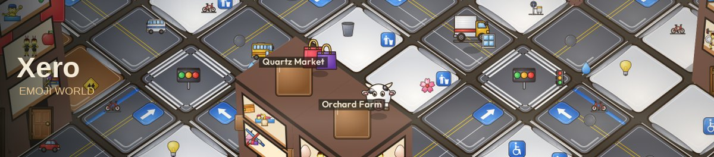

# Xero Emoji World



Xero is a future city that builds itself out of emoji, and you are standing in one neighborhood of it. The map does not shrink to fit the screen. It is already dozens of tiles across, and it keeps spreading past every edge. Drag toward the dark and there is more ground.

What you are watching is a construction site that learned to be a city. Towers, markets, schools, hospitals, and gas stations do not pop into place. Crews haul timber, brick, steel, glass, and tools to an open lot, and those loads are drawn huge so you can see the floor being paid for while the crane is still up. People walk the sidewalk, reach a door, and step inside. A moment later they are in a window, with the room around them: a cart in a shop, a book in a school, a bed in a hospital.

Venice looks at the categories that already exist and says which one is furthest behind, and what that category should do next. The next lots follow that. Stories, search, and those plans run on private Venice inference, capped at about a dollar a day. The clock itself does not spend the dollar. Keys are not in this repo.

The glyphs are [XeroEmoji](https://github.com/maximusmaximus/xeroemoji), drawn as pictures rather than as a system font. The preview card is [public/og.jpg](public/og.jpg). The banner above is [public/x-banner.jpg](public/x-banner.jpg).

## What is on the canvas

- **A world bigger than the frame.** The header shows the size, such as `37×35 and past the frame`. It can keep growing. Pan and zoom to go find the edge.
- **Open sites.** A rising building keeps a yard of materials and a crane until the floors it was planned for are up.
- **Sidewalks and doors.** Walkers move along the front of a building. Some of them shrink into the doorway and show up in the glass.
- **Civic life.** Stores, gas stations, schools, and hospitals are real kinds, not just renamed towers. Each one has its own window scenes.
- **A sky.** A large moon and sun sit on the horizon. Stars and a planet come out as the city gets older.
- **People watching.** The header counts live tabs. More watchers, faster steps, and a more specific next building.

One finger, or the mouse, turns the view. Drag down to look across the city. Two fingers pan and pinch. The wheel zooms. Tap any emoji for its story. The city is saved in the browser, so a refresh continues the same place.

## Live prototype

The city you can open now is the Grok build in [prototype/](prototype/). That is the isometric world, the yards, the sidewalks, and the Venice plans. See [docs/CIVILIZATION.md](docs/CIVILIZATION.md). The Docker apps below are the earlier server layout.

Venice keys stay off the repo. Put one in `.secrets/` on the host, or paste it from the Venice badge. When a key is spent or rejected, that badge asks for another. `.secrets/` is gitignored.

## 🔮 How the world grows: emoji-alchemy + the Oracle
The city is built **out of emojis**, not just decorated with them.

1. **Harvest.** Every 5 ticks each completed building yields its district's element emojis (industrial 🧱🔥⚙️, waterfront 💧🌊, old town 📜🪨, tech ⚡💡🧲, parkland 🌳🌱🍯, residential 🍞🌱, downtown 🪙💡). Population adds 🪙. Stockpiles spoil 3% per harvest.
2. **Build.** Every new floor costs 🧱×3. When bricks run out, sites show 🚧 and stall until someone fires more.
3. **Alchemy.** Residents combine two emojis into a new one (🪨+🔥→🧱, 💡+📜→📚, 🔭+💎→🌌, 🌌+🔮→🪄, 🪄+🔥→🐉, …). Each new emoji discovered raises **knowledge**. Discovered emojis become inputs for further recipes, so the recipe graph keeps branching.
4. **Compounding.** The harvest multiplier is `1.12^knowledge × (1 + 0.25 × wonders)`, so production grows exponentially. Eras advance at `floor(log2(1 + knowledge))` (Age of Clay → Bread → Gears → Light → Stars → Crystals → Magic → Dragons → Myth). Wonder prices scale with the multiplier and spoilage keeps the economy a race, so growth never becomes a flat runaway.
5. **Demand-driven city life.** Construction scales with crowding (residents ÷ 2 × apartments). Immigration scales with vacancy, mood and wonders. A new district is founded when the city runs out of lots or homes, not by a coin flip. Unhappy residents move out more often.
6. **The Oracle (inference).** Every `ORACLE_EVERY_TICKS` the server sends a compact world summary (era, materials, discoveries, wonders, recent events) to an OpenAI-compatible chat endpoint (xAI `grok-4.7` by default). The model returns a JSON **decree** containing an era name, a prophecy, **new recipes**, a **wonder** to raise from emojis, and **behaviour multipliers** (`found, build, immigrate, family, economy, leisure, streets, alchemy, wonder`, clamped to 0.33–3). Citizens pour materials into the wonder until it rises as a real landmark building made of that emoji, and every wonder speeds up the whole economy.
   - Model output is untrusted. `sanitizeDecree` drops unknown emojis and duplicate recipes, clamps every number, and strips markup.
   - The decree becomes an ordinary `world.decree` action/patch, so browsers replay it in lockstep and runs stay reproducible.
   - The call is async and never blocks the tick loop. Without a key, or on error or timeout, a deterministic **local oracle** issues the decree instead. The ⓘ panel shows who is steering (`🔮 llm:grok-4.7` or `🔮 local`).

`GET /api/world` returns the full world layer (era, materials, recipes, wonders, chronicle).

### Environment variables
| var | default | meaning |
|---|---|---|
| `ORACLE` | `auto` | `auto` uses the LLM when a key is set, otherwise local. `llm` / `local` force one or the other |
| `ORACLE_API_KEY` | (falls back to `XAI_API_KEY`) | inference key. **Never commit it.** |
| `ORACLE_API_URL` | `https://api.x.ai/v1/chat/completions` | any OpenAI-compatible chat endpoint |
| `ORACLE_MODEL` | `grok-4.7` | model id |
| `ORACLE_EVERY_TICKS` | `120` | how often the oracle is consulted |
| `ORACLE_TIMEOUT_MS` | `30000` | inference timeout; on timeout the local oracle decides |

All other variables are in [.env.example](.env.example).

## Development checks
```bash
npm run lint && npm run typecheck && npm test   # or: npm run check
npm run build && npm run smoke                  # e2e: sim-server + vite preview + headless Chrome + mock LLM oracle
```
The smoke test needs Chrome (`CHROME_PATH`, default `/usr/bin/google-chrome`). By default it runs a local mock inference endpoint. To smoke against a real model, set `SMOKE_ORACLE_URL` and `ORACLE_API_KEY`.

## Quick start
```bash
cp .env.example .env
docker compose up -d qdrant         # vector DB
npm install
npm run dev:server                   # sim starts ticking; first run = genesis "now"
npm run dev:web                      # http://localhost:5173
```
To run without Docker, use `STORE=memory npm run dev:server` (not durable).
To run everything in Docker: `docker compose up --build` → http://localhost:8080

The canvas prototype in `prototype/` is a TanStack app. From that directory: `npm install` and `npm run dev`.

## Layout
```
packages/shared   emoji catalog, PRNG, generator, reducer, simulation rules, protocol (pure, tested)
apps/sim-server   tick loop, Qdrant store, embedder, HTTP/WS/SSE API, backups, restore script
apps/web          Vite + Canvas2D isometric renderer, story panel, close-up popup
prototype/        the living city: yards, sidewalks, Venice plans, share cards
```
See [ARCHITECTURE.md](ARCHITECTURE.md), [docs/WORKFLOW.md](docs/WORKFLOW.md), and [HANDOFF.md](HANDOFF.md). License: MIT.

## Embeddings & Venice.ai
By default the sim uses a local hash embedder (offline, deterministic). Production inference is private Venice:

- Voice and plans: `grok-4-20`, with `reasoning_effort` set to `none`
- Memory: `text-embedding-qwen3-8b` (4096-d)
- Budget: `$1` per Pacific day
- Each plan names a focus category and a next step for every category already standing

See [docs/MODELS.md](docs/MODELS.md) and [docs/SECRETS.md](docs/SECRETS.md). Changing the embedder or dimensions requires new Qdrant collections.

## Contributing / Grok workflow
Prototype and product are built with Grok agents. Preferred flow:
1. Read [docs/WORKFLOW.md](docs/WORKFLOW.md) before adding a pass. Make and project stay free. Remember and speak are the only paid passes, and they are cached.
2. Agents open PRs (or push to `main` when asked) with that pipeline intact.
3. Review on GitHub (enable Watch + notifications to see acceptance/merges).
See [HANDOFF.md](HANDOFF.md) for bring-up and [docs/SECRETS.md](docs/SECRETS.md) for keys.
